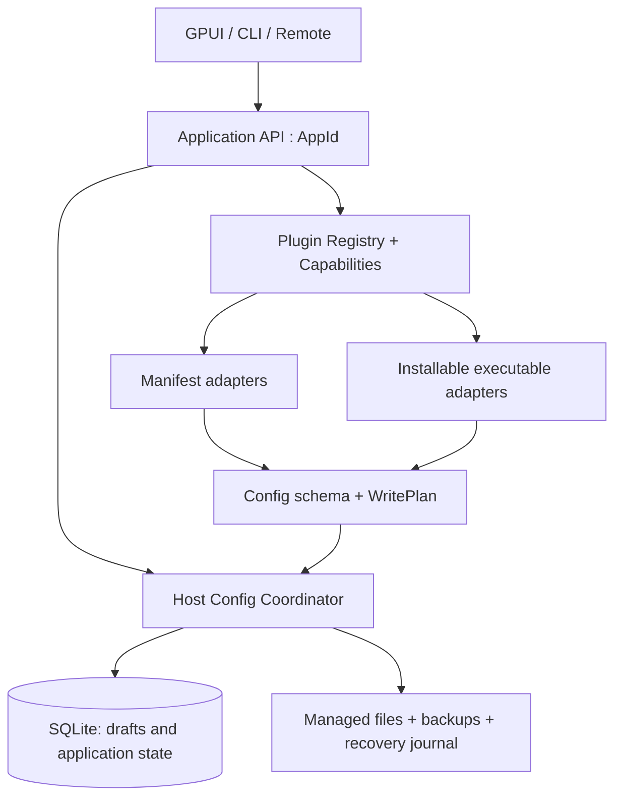

# Config 保存与应用插件化审计

日期：2026-10-13（Asia/Singapore）。目标：测试当前项目，分析 config 保存是否可靠，并规划“新增受管应用只需安装插件，无需修改 OcHub 主程序”的改造。

**结论：正常保存可用，但保存失败后的状态不可靠；已有插件基础，还没有完成桌面应用的插件化。** 本轮保留生产代码，新增故障复现脚本与本报告，便于先确认行为契约再修复。这里的“测试完成”指下述本机测试和审计已执行，不代表所有功能、平台和外部服务均已验收，也不代表缺陷已修复。

## 测试基线与结果

- 工作树基于 `76410200193d4f2a22ffe721e688bb8322d19466`，版本 `0.5.24`。
- 环境为 macOS 27.0 / Apple Silicon，Rust/Cargo 1.98.1，完整 Xcode。
- 测试使用当前工作树，包括原有的 Cargo/toolchain、Codex launcher、三种语言的 shell 文案改动；这些原有改动未被覆盖。
- 原始命令日志、故障结果、GUI 的 AX 树和截图保存在本机 `/tmp/ochub-audit-20261013/`。

| 检查 | 实际结果 | 证据文件 |
| --- | --- | --- |
| `cargo fmt --all -- --check` | 通过 | `fmt.log` |
| `cargo check --workspace --all-targets --locked` | 通过 | `check.log` |
| `cargo clippy --workspace --all-targets --locked -- -D warnings` | 失败：`gateway/server.rs:62` 的 `Result<Option<GatewayKey>, Response>` 触发 `clippy::result_large_err` | `clippy.log` |
| 在命令行临时允许上述单个 lint 的诊断复查 | 其余 workspace/all-targets Clippy 通过；不算严格门禁通过 | `clippy-diagnostic.log` |
| 不把 warning 升级为 error 的全量 Clippy 复查 | 自有代码只有上述 1 条 Clippy 警告（lib/test 重复报告），其余目标完成检查 | `clippy-all-warnings.log` |
| `cargo test --workspace --locked --no-fail-fast` | 首轮 **1,160 通过、1 失败、2 ignored** | `workspace-tests.log` |
| 单独运行首轮失败项 | 通过 | `path-test-serial.log` |
| 同一 workspace 构建的 core 测试二进制串行运行 | **945 通过、2 ignored** | `core-serial.log` |
| 同一 core 二进制再运行 5 轮默认并行测试 | 每轮 945 通过、2 ignored | `parallel-repeats.json`、`core-parallel-*.log` |
| 新增保存故障检查 | **12 个检查：2 个正常对照通过，10 个预期不变量失败，0 个脚本执行错误** | `config-repros.json` |
| `just qa-app` | 通过，构建并验收 `/tmp/OCHUB-QA.app` | `qa-build.log` |
| QA 包核对 | Bundle ID 为 `io.ochub.debug.qa`，19 个 assets 文件无缺失/差异，二进制与 `target/qa/ochub` 相同 | `qa-package-check.json` |
| 脚本语法 | 7 个 shell 脚本通过 `bash -n`，2 个 Python 脚本通过 AST 解析 | 本轮命令输出 |
| `git diff --check` | 通过 | 本轮命令输出 |

首轮各测试目标的结果如下。数字是执行数量，不是代码覆盖率。

| 测试目标 | 通过 | 失败 | 忽略 |
| --- | ---: | ---: | ---: |
| CLI library | 17 | 0 | 0 |
| CLI smoke | 12 | 0 | 0 |
| Remote stdio integration | 18 | 0 | 0 |
| GPUI app helpers / source checks | 119 | 0 | 0 |
| Protocol conversion | 45 | 0 | 0 |
| Core | 944 | 1 | 2 |
| Remote protocol | 5 | 0 | 0 |

首轮失败项为 `paths::tests::abbreviate_home_replaces_only_the_home_prefix`（`crates/core/src/paths.rs:391`）。它先读取 `get_home_dir()` 再调用内部也会读取 home 的 `abbreviate_home()`，却没有获取其他环境变量测试使用的 `test_support::env_lock()`。首轮两次读取碰到了不同的测试 home；单项、串行和随后 5 轮并行均通过。应补共享锁并审查其他环境变量读取测试，不能用一次重跑变绿消除首轮失败记录。

两个 ignored 测试为真实 S3 连接与 PUT/GET/HEAD 往返测试。本环境没有 `S3_TEST_AK`、`S3_TEST_SK`、`S3_TEST_BUCKET`、`S3_TEST_ENDPOINT`。Linux/Windows CI、真实 SSH 远端、第三方模型请求、OAuth 登录、真实 WebDAV/S3 同步和升级安装未做实际环境验收。Remote stdio 的 18 项集成测试不等同于真实 SSH 服务器验收。发布安装器只做了可在本机进行的脚本语法检查，不能据此声明跨平台安装已通过。

`plugin/manifest_tests.rs` 还有若干 `#[cfg(any())]` 的旧 Gemini 等价测试，这些代码根本不参与编译，不会计入 ignored 数量；目前测试数量也不能证明这些旧等价断言仍有效。

## Config 实际保存在哪里

| 数据 | 当前保存位置与职责 |
| --- | --- |
| 供应商配置、公共片段、MCP 等共享数据 | `ochub.db`，供应商主体在 `providers.settings_config`，公共片段在数据库 settings 表 |
| 语言、主题、目录覆盖、设备当前供应商 | `~/.ochub/settings.json`；此路径固定在 home 下，不随 `--data-dir` 改变 |
| 数据目录入口 | 固定 bootstrap 文件 `~/.ochub/app_paths.json`，以及进程参数/环境覆盖 |
| 受管应用真正读取的配置 | `.claude/settings.json`、`.codex/config.toml` / `auth.json`、各应用的 JSON/TOML/YAML 等 live 文件 |
| 旧 `config.json` | 旧格式及迁移输入；当前常规供应商保存通过 SQLite，不能用旧 JSON 是否变化来判断保存是否成功 |

内置应用的设备级 `currentProvider*` 优先于数据库 `is_current`，见 `settings.rs:1041`。这意味着一项操作可能涉及数据库、设备设置、一个或多个 live 文件，以及后续 MCP 同步。数据库中单次 `save_provider()` 有 SQLite 事务，许多 live 文件也使用临时文件替换；问题是这些保护没有覆盖整项业务操作。

Codex 还有明确的草稿语义：编辑器“保存”调用 `save_codex_draft()`，只保存数据库；“保存并启用”或切换连接才应用到 live 文件。`cli_smoke::codex_draft_save_leaves_live_files_untouched_until_switch` 已通过，GUI 也确认存在这两个按钮。单独点击“保存”后 `config.toml` 不变化，在这条路径上是现有设计。

## 已复现的保存问题

运行方式：

```bash
cargo build -p ochcli --locked
python3 scripts/qa/audit_config_persistence.py --binary target/debug/ochcli
```

脚本通过真实 CLI 操作临时 home，以临时目录权限注入写入失败；使用虚构 token 和 `example.invalid`，结束时清理临时数据。要求非 root Unix 用户。当前退出码 **1 是成功复现缺陷的结果**；结果中的 `harnessError` 才代表复现脚本本身未完成检查。可用 `--output /tmp/config-results.json` 保存完整结果。

| 优先级 / 检查 | 操作与实际结果 | 主要位置 |
| --- | --- | --- |
| P1：`switch_write_failure` | A 为当前连接，阻止 live 目录写入后切换 B。CLI 返回 `PERMISSION_DENIED`，但数据库和设备设置都变成 B，live 仍是 A。下一次读取“当前连接”会误导用户。 | `services/provider.rs:659`：先更新两个 current，再调用 live writer |
| P1：`update_write_failure` | 修改当前连接的配置，阻止 live 写入。CLI 返回失败，数据库却已存入新配置，live 保持旧配置。 | `services/provider.rs:400` |
| P1：`common_snippet_write_failure` | 保存公共片段，阻止当前连接 live 写入。操作返回失败，但新的公共片段已留在数据库中。 | `services/config.rs:72` |
| P1：`damaged_settings` | 提供截断的 `settings.json`，执行一次普通 setting 修改。操作成功返回，原文件被默认设置覆盖，未发现保留原字节的备份。 | `settings.rs:730`、`settings.rs:755`，启动迁移也会触发保存 |
| P1：`plugin_multifile_failure` | 插件声明两个配置文件，阻止第二个目录写入后切换。第一个文件已变为 B，第二个仍是 A，数据库 current 仍是 A。 | `plugin/plugin_manifest.rs:156`：逐文件写入，没有整组恢复 |
| P1：`plugin_secret_roundtrip` | 读取脱敏的自定义插件连接，只修改名称后将整份记录写回。原密钥被字面量 `******` 覆盖。内置应用有恢复脱敏占位符的逻辑，generic 分支没有。 | `application/providers.rs:204` 对比 `services/provider.rs:257` |
| P1：`plugin_additive_semantics` | 安装 `mode = "additive"` 的合法 manifest，依次添加 A、B 到 live。文件只剩 B；remove-from-live 返回不支持。 | `plugin/manifest.rs:470` 接受 additive；`plugin/plugin_manifest.rs:171` 拒绝删除且写入没有 provider-key 操作 |
| P1：`plugin_path_confinement` | manifest 将相对文件路径设为 `../outside-plugin.json`。安装和切换均成功，在声明的配置目录外写出了文件。复现仍完全限制在临时 home 内。 | `plugin/manifest.rs:495` 缺少路径边界校验；`plugin/plugin_manifest.rs` 直接 join |
| P2：`plugin_replace_absent` | `write = "replace"` 且 `absent_preserves = true`，切换到缺少 store 的连接。原文件被覆盖为 `{}`。 | `plugin/plugin_manifest.rs:208`：该标志只在 merge 分支生效 |
| P2：`plugin_json_permissions` | JSON merge 指定 `file_mode = "0600"`、`dir_mode = "0700"`。预先存在的 0644 文件和 0755 目录在写入后保持原权限。 | `plugin/plugin_manifest.rs` 的 JSON merge 分支绕过 `write_leaf()` |

正常对照同时通过：内置 Claude 成功切换后三处状态一致；新 manifest 插件可以完成 JSON、TOML、YAML、env 四种文件的写入与读取，重复预览不产生 drift。因此上述失败不是 CLI 或临时目录整体不可用导致的。

对“数据库已保存但应用失败”的修复需要先规定语义：

- 切换连接：直到目标文件提交成功之前，不能把 current 改成目标连接。
- 保存草稿：允许只更新数据库，必须明确返回草稿版本及尚未应用的状态。
- 保存并应用：失败时回滚已生效的副作用，或返回明确的“草稿已保存 / 应用失败 / 需恢复”结果。不能仅显示“保存失败”却留下未说明的新数据库状态。
- 公共片段和 MCP 同步：纳入同一次应用计划，或者明确区分主操作成功与后续同步失败，提供可重试的操作记录。

## 代码审查发现的额外风险

以下是代码证据，不能与上面已经执行的故障复现混为一谈。

1. `settings.rs:773` 使用 `truncate(true)` 直接覆盖，没有临时文件替换或 `sync_all()`。进程在截断后终止、磁盘写入中断时可能留下空文件/半文件。随后默认回退又会放大数据丢失。尚未通过杀进程或真实磁盘故障验证崩溃窗口。
2. `update_settings()` 在获取内存写锁之前写盘；`mutate_settings()` 才将读改写置于锁内。CLI/daemon 还有 `MutationGuard`，但 GUI 偏好写入直接调用 `mutate_settings()`。不能把其中一个锁等同于覆盖所有入口的业务串行化；这轮未将并发丢失更新作为已复现缺陷。
3. `paths::atomic_write()` 的 `flush()` 不等同于落盘持久性，失败后临时文件也缺少统一清理；Windows 分支还先删除目标文件再 rename。这需要单独做 Windows 故障测试，不能据 macOS 成功推断其原子性。
4. Codex 的 auth/config 写入已有第二步失败时恢复 auth 的补偿逻辑，但恢复错误被忽略，模型目录等附加文件也不属于一个统一的写入计划。现有局部补偿值得保留并迁入公共执行器，不能假定已覆盖全部业务状态。
5. 设备设置写入的 `.mode(0o600)` 只作用于新建文件；GUI fixture 原有的 0644 settings 在保存后仍为 0644。统一私密文件写入策略应处理旧文件和临时文件权限。

## 原生界面验收

通过 `just qa-app` 构建固定包，以 `OCHUB_TEST_HOME=/tmp/ochub-audit-20261013/gui-home` 启动，通过 node_repl/sky 读取 AX 树、按索引操作、截图并刷新状态。验收后退出应用，保留 `/tmp/OCHUB-QA.app`。

| 路径 | 结果与边界 |
| --- | --- |
| Claude 连接切换、编辑、保存 | A → B 成功；名称保存成功；数据库、设备 current、live Base URL 一致 |
| 偏好与主题 | 系统菜单选项保存；固定深色主题即时生效 |
| 退出并重启 | `audit-beta-edited`、当前 B、深色主题、`showInTray=false` 均保留；见 `gui-restart-check.json` |
| 应用与插件管理 | 自定义 `audit-app` 在管理页显示已启用，CLI 同样返回 enabled；但主侧栏不显示它，无法打开其连接页 |
| Codex 编辑器 | 确认“检查配置 / 保存并启用 / 保存 / 取消”等动作；草稿实际行为由已通过的 CLI 集成测试验证 |
| MCP、Skills、用量、会话、高级工具、模型供应商、代理、远程节点、主题、关于 | 检查页面渲染、主要入口、空状态/现有数据状态；这属于冒烟，不代表每个按钮的外部副作用已验收 |

有一项测试隔离缺口：OpenCode 会话路径通过 `dirs::home_dir()` / `XDG_DATA_HOME` 解析，未使用 `OCHUB_TEST_HOME`（`session_manager/providers/opencode.rs:16`）；Cherry Studio 也直接使用真实 home（`apps/cherry_studio.rs:24`）。首次会话页读取到了真实 OpenCode 会话列表，本轮未操作这些会话。第二次启动为该测试子进程另设临时 `XDG_DATA_HOME` 后，会话页为空，确认了路径来源。含真实会话标题的截图仅留在本机临时证据目录，未加入仓库。

## 插件化距离目标还有哪些差距

当前已具备 `AppId`、`AppPlugin`、`PluginRegistry`、manifest loader、通用表单 codec、四种文件格式、CLI install/reload/remove，以及动态应用的基本 provider CRUD。应复用这些已有结构。

| 边界 | 当前限制 | 必要改造 |
| --- | --- | --- |
| GUI 的应用身份 | `AppRoot.selected_app` / `visible_apps` 和 `ProviderEditor` 仍是 `AppType`。`load_visible_apps()` 把不能转成枚举的插件过滤掉 | 页面、导航、编辑器、选择器、缓存键全部使用 `AppId` 和动态元数据 |
| 内置与外部应用操作 | Application provider 分成 `AppType::from_app_id` 和 generic 两套路径，secret 保护、失败语义、复制和导入支持不一致 | 一套应用操作编排；应用差异由能力接口提供 |
| 可选功能 | manifest 的 MCP/Skills 永远返回 false；session、gateway、provider ops 等继续要求 builtin | 用可选能力接口描述功能，按能力显示入口并返回 unsupported；不让 UI 根据 app 名称猜能力 |
| 当前连接与目录 | `AppSettings` 仍有每应用专用的 current/config_dir 字段；不同模块自行解析 home | 保留迁移兼容，统一成按 `AppId` 索引的设备状态、目录上下文 |
| MCP/Skills 关联 | 数据库还有 `enabled_claude`、`enabled_codex` 等固定列 | 改为应用 ID 关联表或等价的开放映射，新增应用不再改 schema |
| 文件写入 | 插件直接收到 `Database`，自己逐文件写；权限、回滚、drift 语义不一致 | 插件只生成可审查的 `WritePlan`，由宿主执行文件与数据库的协调提交 |
| Manifest 文件操作 | additive 缺少插入/删除 provider-key 语义；replace/merge 选项行为不一致 | 明确对象路径、所属键、删除规则、空值/缺失规则，预览和实际写入共用计划 |
| 自定义行为 | `HookRegistry::builtin()` 为空，hook 实现必须是编译进程序的 Rust | 增加可安装的可执行扩展接口，复杂应用适配也能随插件交付 |
| 插件生命周期 | 当前是单个 `.toml` 扫描；schema 版本不等于插件自身版本或宿主 API 版本 | 包、版本、API 范围、资源、升级迁移、兼容性检查和失败恢复 |
| Reload | 先卸载所有 user plugins，再逐个重新加载；坏更新会让原插件消失 | 先构建并验证候选 registry，再整体交换；保留正在使用的旧实例直至操作结束 |

把侧栏的枚举改成字符串，只能解决“显示出来”。仅扩展 manifest，只能覆盖现有声明式能力。要达到用户确认的目标，还必须让特殊格式、复杂认证、会话解析等新行为通过插件交付，而不是每新增一个 hook 就修改主程序。

## 推荐的目标边界



建议新增一个轻量的 `ochub-plugin-api` crate，把可序列化契约从数据库、GPUI 和 native app 实现中分离。`ochub-core` 保留业务编排和可信写入器；内置插件和安装插件遵循同一契约。以下是设计草案，不是当前已实现的 API：

```text
PluginDescriptor
  id, plugin_version, host_api_range, display metadata, capabilities

AppContext
  AppId, resolved config/data/auth roots, platform, granted capabilities

ConfigAdapter
  schema(), decode(snapshot), encode(form, prior), validate(provider)
  plan_apply(provider, snapshot) -> WritePlan
  plan_remove(provider_id, snapshot) -> WritePlan   // additive capability

WritePlan
  expected file revisions / hashes
  scoped file operations + intended permissions + ownership rules
  desired applied provider / draft revision
  preview and recovery information

ApplyResult
  draft_saved, live_applied, applied_revision, recovery_required, warnings
```

**宿主负责一致性。** 所有入口进入同一个串行化协调器：读取快照与修订号，验证路径/权限/配置，计算 drift 和预览，先完成全部序列化及临时文件准备，记录恢复日志，再执行替换；最后更新设备当前连接与数据库的应用状态。失败时恢复已提交的文件及相应状态；如果恢复本身失败，保留恢复所需数据，并阻止“假装成功”继续操作。

SQLite 事务不能自动把多个外部文件变成一个事务，多个 rename 也不能保证外部应用看到它们在同一个瞬间切换。设计应明确提供可恢复提交、失败回滚、冲突检测和启动恢复，而不是笼统承诺多文件绝对原子性。已有 runtime journal 可复用为协调入口，但目前记录操作失败并不会自动恢复前述状态。

**插件负责转换与能力，宿主负责文件系统和密钥。** 通用 secret 更新应使用明确的“保留 / 替换 / 清除”操作或 secret 引用，避免让 `******` 作为可写密钥值往返。JSON/TOML/YAML/env 的预览与提交要使用同一转换结果；不能预览一份配置再由另一套分支重新生成另一份。

**路径来自同一个上下文。** 支持按平台声明多个命名根目录，例如 config、data、auth；文件仅能在授权的命名根内解析。合法的跨目录布局用显式根目录表示，不能依赖 `../` 绕过约束。检查绝对路径、父目录跳转、重复目标、符号链接以及多个插件写同一文件的所有权冲突。测试通过注入 `AppContext` 覆盖路径，不再依靠进程全局 HOME 或各模块自己的 dirs 调用。

**复杂扩展保留稳定的可安装边界。** 纯配置应用优先用声明式 manifest；需要执行自定义逻辑的应用采用版本化扩展协议，可选择受限运行时组件或独立进程 RPC。需要先做一款复杂应用的原型，验证超时、取消、崩溃、升级、输出大小和权限限制，再冻结 SDK。进程隔离本身只隔离崩溃，不自动限制子进程的文件系统权限。无论选哪种运行时，扩展应返回计划，通过宿主能力接口产生副作用；不能重新引入只对内置 Rust hook 开放的功能。

## 建议实施顺序与验收标准

1. **先定义并修复保存契约。** 保留 Codex 的草稿/启用区分，把当前连接、公共片段、插件文件组和后续同步纳入可恢复的应用流程。先补失败路径回归，再修 settings 的原子替换、坏文件保留、权限和统一锁边界。当前 10 个失败场景应逐个得到明确的成功拒绝、回滚或部分成功结果。
2. **让未知 AppId 贯通桌面。** 修改 `app_ui.rs`、`app_meta.rs`、`provider_editor.rs`、各应用选择器、remote DTO 与缓存；统一 Application 的 native/generic 操作入口。验收：安装一个主程序编译时未知的 ID 后，侧栏出现，能打开动态表单并完成新增、编辑、预览、保存、切换、禁用、重启恢复。
3. **开放数据模型与能力。** 迁移固定 current/config_dir 字段，规范 MCP/Skills 的动态应用关联。保持旧设备设置、provider ID、云端数据库和 schema 升级的兼容。启用/禁用、删除插件和删除用户配置应有清楚的不同语义，插件卸载默认保留用户数据。
4. **完成 manifest 写入引擎。** 修复 replace/merge 的参数语义，增加 additive provider 路径、upsert/remove、字段所有权、格式保留策略和路径约束；文件计划由宿主统一执行。迁入内置应用时保留其注释、未知字段、用户外部修改和凭据规则，用真实 fixture 做等价测试。
5. **交付 SDK、复杂适配运行时和插件包生命周期。** 插件版本/API 版本分开；支持校验、安装、重载、升级、回退和资源加载。更新前验证候选包，失败保留旧插件；不允许旧任务在卸载/重载中突然拿到不同的写入器。至少用一款需要自定义逻辑的应用证明“只安装插件”也成立。
6. **完成发布门禁与开发文档。** 修复严格 Clippy 和环境变量测试竞态；执行 macOS/Linux/Windows 的配置、权限和恢复测试。用户可见行为实施后，在相邻 `../ochub-docs` 更新、验证并提交文档，主仓库仅保留设计/开发资料。

最终验收至少包含：未知 ID 安装并出现在 GUI；四种格式往返；switch 与 additive CRUD；已有 app 的完整回归；脱敏读取后编辑不破坏密钥；外部编辑冲突；第二文件失败；DB 提交失败；恢复失败；进程中断后重启恢复；并发 GUI/CLI/RPC；插件更新失败回退；MCP/Skills/session 等按能力出现；插件禁用/卸载保留数据；平台路径、权限与符号链接边界。

本轮能够支持的决策是：**先统一保存与应用的一致性，再打通动态 AppId 和能力接口，最后把复杂适配及插件生命周期做成可安装边界。** 在当前直接写文件的插件接口上继续增加应用，会同时扩大故障路径和两套业务逻辑的差异。
