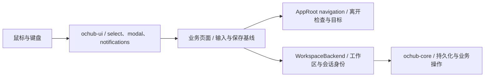

# 交互审查与代码整改 · 2026-10-14

## 视觉反模式结论

原生验收已在独立测试数据中取得 960×640 窗口截图，核对通知中心、环境下拉及修改离开提示。中性表面、语义状态色和统一控件尺寸得以保留。后续路由预览与共同依赖验证见 [联合迭代记录](JOINT-UI-ITERATION-2026-10-14.md)。没有为了统一样式改写为 WebView。

本轮发现的主要问题是状态和事件的归属不明确：下拉菜单的鼠标关闭与键盘激活互相干扰，页面重载重置了编辑状态，退出流程只保护连接编辑器。整改围绕这些可复现行为展开。

## 审查结果

共整理 11 项问题：6 项高优先级、5 项中优先级。下表列出触发条件、影响和本轮处理。输入事件测试使用实际 GPUI 元素树；其结果不等同于原生 AX 验收。

| 优先级 | 问题与影响 | 本轮处理与依据 |
| --- | --- | --- |
| 高 | 先展开下拉，再打开确认弹窗，旧菜单仍在上层响应点击 | 下拉菜单跟随焦点归属；失去焦点后关闭旧列表。原始失败用例已转为通过 |
| 高 | 通知中心打开时按保存快捷键，会提交背后的表单 | 通知中心消费保存动作；主窗口同时拒绝转发。保留 Escape、Tab 和复制行为 |
| 高 | 同步草稿未绑定环境，切换后保存会使用新的后端 | 草稿记录所属后端；切换前检查修改；写入前验证所属环境，离线时拒绝写入 |
| 高 | 关闭窗口和切换页面只检查连接编辑器，其他表单可能丢失修改 | 主窗口统一检查 8 类表单的修改与写入状态，处理返回编辑、放弃后继续及多表单情况 |
| 高 | 断线或重新进入页面会重建 MCP、代理、应用目录、中转站及高级配置输入 | 区分同一工作区、重连和切换；保留断线输入；刷新只更新未修改的内容；按已验证节点识别重连 |
| 高 | 更新完成直接退出；重开关于页会清除运行中的安装状态 | 重启走主窗口退出检查；安装任务拥有独立运行标志，页面重载不再解除重复提交保护 |
| 中 | 再次点击已打开的下拉触发器，菜单关闭后立即重开 | 外部按下事件排除触发器范围，由触发器的 click 完成一次开关 |
| 中 | 下拉列表不支持方向键、Home/End 后确认选择 | 增加活动选项、滚动定位与键盘导航；Enter/Space 沿用 GPUI 合成点击，避免双重提交 |
| 中 | 中转站确认层的 Escape 会同时移除下面的编辑器 | 先关闭顶部只读或确认层，编辑器取消单独经过修改检查 |
| 中 | 离线同步保存先进入 saving 再返回，且按钮看似可用 | 可用性和所属环境检查前移；离线显示保留输入的说明，禁用保存、测试、上传和恢复 |
| 中 | 应用目录和高级配置的异步读取会覆盖读取前已经存在的修改 | 读取前记录基线，返回后比较；高级配置分别保存 6 个字段的基线 |

## 代码边界

- `ochub-ui/src/select.rs` 收拢下拉菜单的临时状态、焦点、键盘和鼠标边界；`components` 保留原 API 的转出，调用方无需批量改名。
- [interaction.rs](../crates/app/src/interaction.rs) 只定义 `Clean / Dirty / Busy` 和表单身份，不持有输入、网络连接或数据库。
- [app_ui/navigation.rs](../crates/app/src/app_ui/navigation.rs) 从根视图拆出保存/取消路由、目标暂存、离开确认和退出续接。多个表单有修改时逐一处理。
- 各业务页继续拥有自己的保存操作、字段验证和基线。普通表单在离开提示中返回原页保存；连接编辑器保留独立的持久草稿流程。
- `WorkspaceBackend` 区分同一连接会话与同一已验证工作区，避免重连复用旧异步结果，也避免把旧草稿带往另一个节点。
- 关于页的安装任务不再依赖页面展示状态。安装完成仍须通过已有退出入口，不绕过编辑保护。
- 构建脚本在执行时读取当前包路径，避免共享构建目录中的缓存脚本读取另一个检出目录的翻译文件。

这些职责划分适用于未来的浏览器前端：业务操作与工作区身份留在后端；焦点、弹层和输入事件由 UI 层处理；导航确认由应用外壳协调。迁移渲染框架本身不能修正这些状态错误。

## 保留的交互规则

- 普通下拉点击外部关闭；有未保存内容的编辑器通过明确操作离开，避免把点击空白处当成放弃修改。
- Escape 先处理顶部层，再处理下面的编辑器。
- 可点击控件保留指针、键盘焦点和禁用状态。文本输入已有 I-beam 指针、拖选和外部松开结束选区行为。
- 插件列表折叠只影响导航展开；“停用管理”是另一项明确操作，保留现有连接和工具配置。最后一个受管理应用仍有禁用保护。
- 动画用于开合和状态反馈；不把循环动画作为任务已完成的证据。原生减少动态效果、系统指针和实际命中范围仍在实机清单中。

交互预期参考 [WAI-ARIA combobox](https://www.w3.org/WAI/ARIA/apg/patterns/combobox/)、[modal dialog](https://www.w3.org/WAI/ARIA/apg/patterns/dialog-modal/) 与 [Radix Select](https://www.radix-ui.com/primitives/docs/components/select)。原生 GPUI 的实现需要使用自己的焦点树和输入事件；这些参考不构成无障碍合规认证。

## 验证与交付记录

- 解除沙箱限制后，主仓库完整测试为 1,233 通过、0 失败、2 忽略；此前套接字权限导致的失败均已解决。最新应用测试为 136 项通过。
- 组件库的交互回归包含下拉焦点、通知层、输入法组合态与密码按词编辑；共同 GPUI 版本的最终结果统一记录在联合迭代报告。
- 主仓库全工作区、全目标 Clippy 通过，仅保留已有 `gateway/server.rs` 的 `result_large_err` 提示。
- 主仓库 `just qa-app` 通过，固定路径 `/tmp/OCHUB-QA.app`，Bundle ID 为 `io.ochub.debug.qa`；包内二进制与构建一致，资源与 `crates/app/assets` 一致。
- 文档已在实际 `../ochub-docs` 仓库提交并验证：127 文件格式检查、42 页三语言一致性、117 文件类型检查通过；构建 130 页，Pagefind 索引 126 页，检查 324 条 WASM 路由。
- UI 与文档的前期签名提交均已同步至正式相邻工作树。本地源码快照来自当前固定提交。保留的 [交付补丁和 bundle](design/interaction-review-2026-10-14/) 仅用于追溯历史基线。
- 本轮提交保留在本地，尚未推送或部署。

### 原生验收

所要求的 `node_repl/sky` 未提供，使用已安装的 cua-driver 完成同样的 AX 读取、元素操作、状态刷新与截图循环。解除沙箱限制后驱动可正常工作，之前的剪贴板初始化故障不再复现。

使用独立 QA 数据启动固定包，依次验证通知中心打开及 Escape 关闭、环境下拉再次点击关闭、代理开关修改后导航被拦截、放弃测试修改后进入总览。每次操作后重新读取 AX 状态；仅退出此次启动的 QA 应用，保留固定包。没有操作正在使用的正式 OcHub 进程。

路由预览和不同宽度的后续截图统一保存在联合迭代记录中。断线与多表单等分支由自动化回归覆盖；Windows / Linux 的原生渲染仍需各自平台验证。
