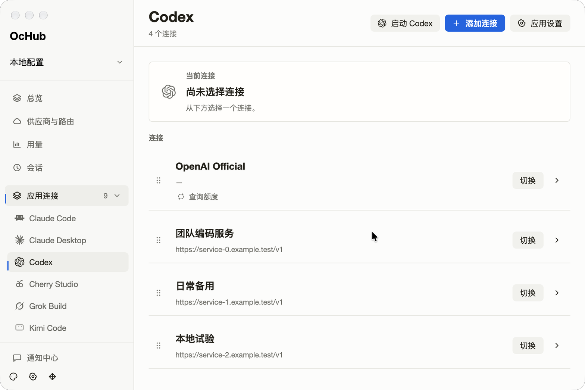
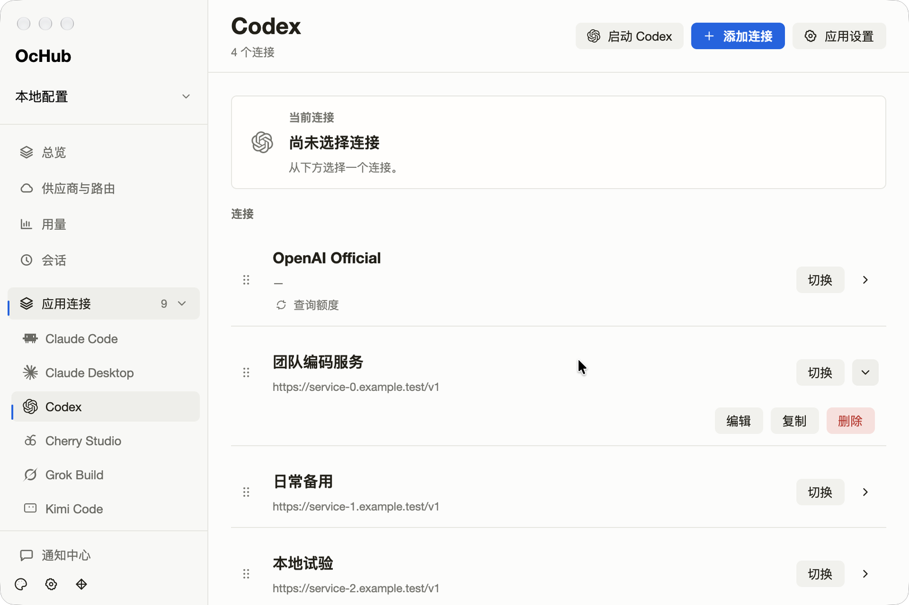
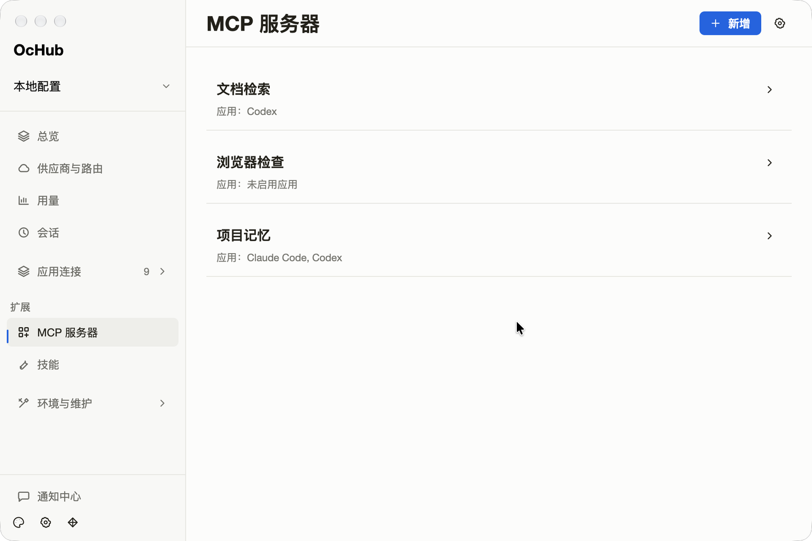
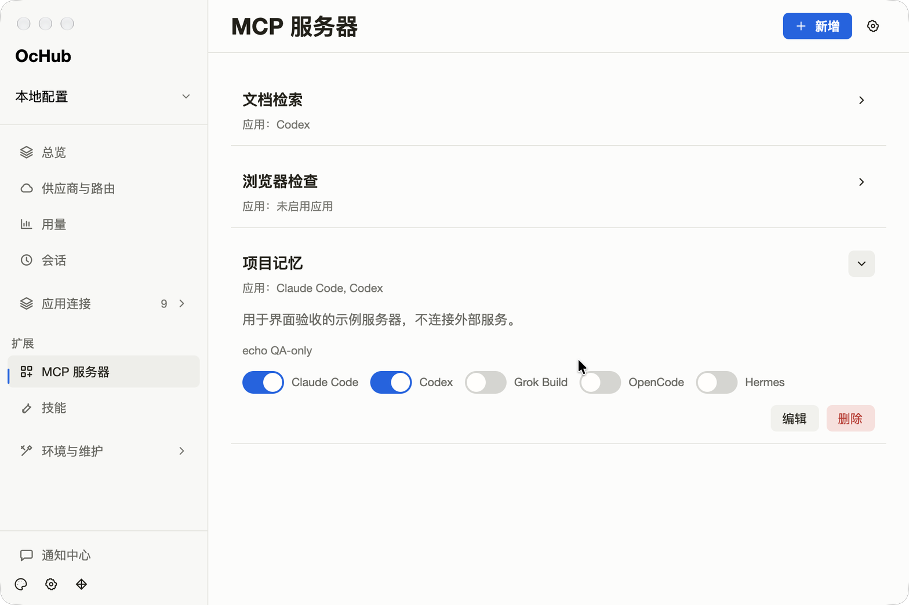
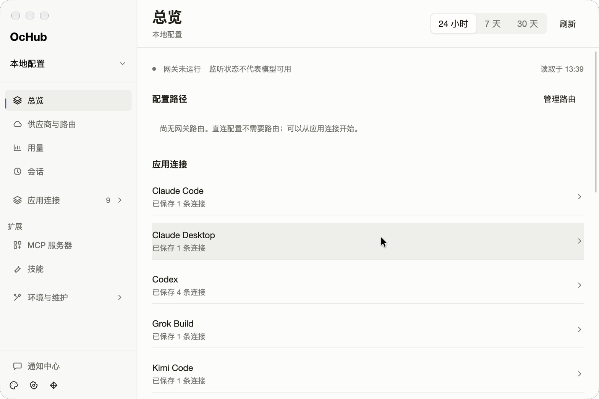
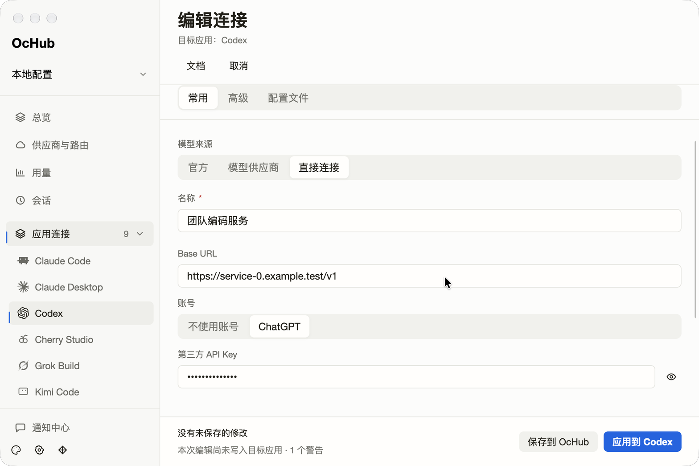

# 界面密度收敛验收（2026-10-14）

本轮针对总览、应用连接、MCP、连接编辑器和侧栏。实际查看界面后，主要问题是同类操作在每一行重复出现、次要操作与主要操作同时争夺注意力，以及说明、边框和图标重复表达相同信息。

## 已完成的收敛

| 位置 | 调整前 | 调整后 |
| --- | --- | --- |
| 应用连接 | 每行常驻编辑、复制、删除、切换四个文字操作 | 默认显示主操作和展开箭头；编辑、复制、删除按需展开，同时只展开一行 |
| 连接列表样式 | 重复应用图标、独立卡片边框和多个强调按钮 | 分隔线列表，移除重复图标，列表操作使用中性色；缩小当前连接区域 |
| MCP | 每个服务器常驻说明、地址、全部应用开关及编辑、删除 | 默认显示名称和已启用应用摘要；一次展开一个服务器的管理内容 |
| MCP 顶栏 | 新增、导入、同步同时展示 | 新增保持可见，导入和同步收进带说明的图标入口 |
| 总览 | 每个应用重复“打开”，多个分区重复跳转到用量 | 应用整行可点击，去掉重复跳转，异常状态仍明确显示 |
| 连接编辑器 | 预设按钮组、复制到应用和检查配置长期同时展示 | 预设改为下拉；已有连接的预设和复制到应用放在高级页；检查配置放在配置文件页 |
| 侧栏 | 网络代理、远程节点、高级工具一直展开 | 合入“环境与维护”可折叠分组；无未读通知时隐藏数字 0 |

展开入口保留无障碍名称和展开状态。MCP 应用开关支持键盘访问；预设下拉打开时，Esc 先关闭下拉，不退出编辑页。保存、应用、删除确认和 MCP 即时同步语义保持原有行为。

## 验收

- 使用 `just qa-app` 构建 `/tmp/OCHUB-QA.app`，Bundle ID 为 `io.ochub.debug.qa`，资源同步至 `Contents/Resources/assets`。补充构建末尾的临时签名，避免覆盖旧包资源后签名失效。
- 在独立 QA 配置中使用示例连接和 MCP 数据，检查 1200×820 和 960×640 窗口。本次环境未提供 `node_repl/sky`，使用 `cua-driver` 按 AX 快照定位操作，每次操作后刷新状态并核对截图。
- 验证总览整行导航、连接行展开与编辑入口、编辑器三个页签、新建连接的预设键盘选择、MCP 单行展开、应用开关和维护入口。
- MCP 开关通过空格键从开启切换为关闭；AX 状态和 QA 数据库均确认变化。
- 最终构建复测预设下拉的 Esc 行为：菜单关闭，编辑器和保存、应用按钮仍在。验收后退出应用，保留固定验收包。
- `cargo fmt --all`、严格 Clippy、`cargo test -p ochub-app --locked --offline` 通过（136 项测试）。
- 相邻 `ochub-docs` 更新中、英、日三语操作说明及 WASM 示例；`pnpm check` 通过（130 个构建页面，文档 lint 和 WASM 路由检查通过）。最后的导航译名调整另通过文档 lint。

以下截图来自独立 QA 配置，地址和密钥均为验收示例。

### 默认连接列表

### 展开次要操作

### MCP 列表与详情

### 总览与已有连接的常用页

